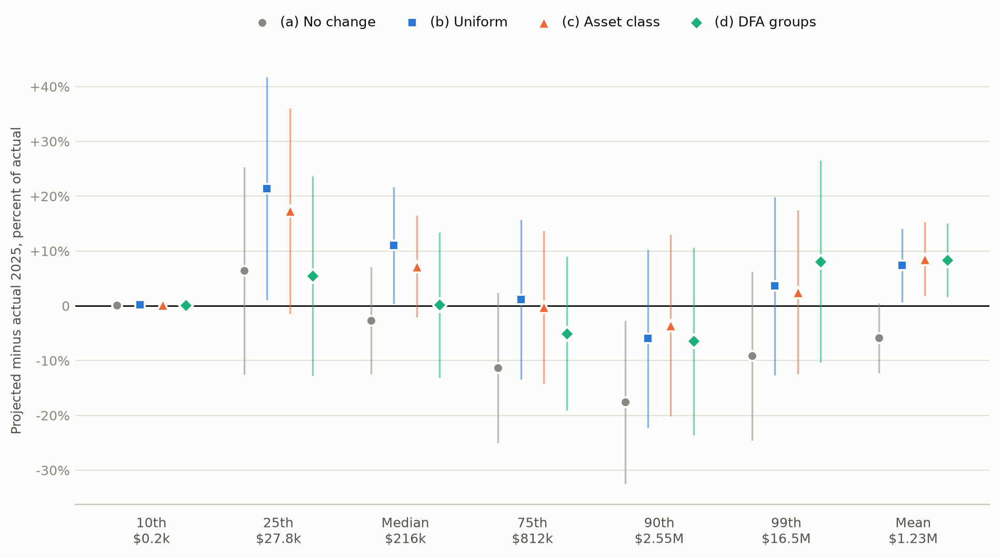
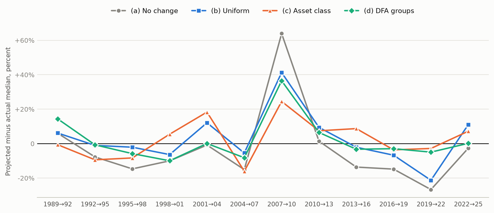

# Aging SCF wealth between survey waves

2026-10-10

Models that need current household wealth take the latest Survey of
Consumer Finances (SCF) and grow it with aggregates from the Federal
Reserve’s Financial Accounts. This report projects every SCF wave from
1989 to 2022 three years forward with four methods and scores each
projection against the wave that followed. The last pair, 2022→2025,
ends in the survey the Fed published on 9 October 2026.

The design was written down and tagged (`prereg-v1`) before the 2025
microdata were opened: methods, statistics, scores and the rules for
calling a winner. The eleven pairs through 2019→2022 were in view while
the methods were built, and one method was changed after looking at
them, as the specification records. The Fed’s report had already given
the 2025 mean and median, so a *blind level* score, over the 25th, 75th,
90th and 99th percentiles, carries the cleanest test.

## Summary

- **The 2022→2025 test.** The lowest level score, over the mean and five
  percentiles, belongs to (d) DFA groups (5.6%, against 8.8% for no
  change). The lowest blind level score, which leaves out the
  already-published mean and median, belongs to (c) Asset class (5.9%
  against 11.1%). The ranking from the development pairs held: (c) beat
  both (a) and (b) on the level and blind level scores.
- **Every aging method overshot the 2025 mean**, by +7.3% to +8.6%,
  outside sampling noise; holding dollars fixed missed it by -5.9%,
  within noise. Financial Accounts household net worth grew 14.1% in
  real terms per household; the SCF mean grew 6.3%. For asset-class
  scaling the overshoot is equities: its projected mean was \$106k per
  family too high, equities contributed \$106k, and the other six
  classes together -\$0.7k. The Financial Accounts equity series grew
  54% in real terms per household; mean SCF equity holdings grew 20%.
- **No method caught the fall in the top 1% share**, from 35.1% to
  31.3%. All four overshot it by 3.2 to 6.1 points, outside noise; DFA
  scaling, which grew the top groups fastest, missed by the most.
- **On subgroup medians doing nothing did best in 2025.** Every method,
  including no change, overshot the under-35 median by +31% to +49%. A
  projection moves dollars, not people, so it cannot follow a change in
  who holds what within an age group.
- **Over all twelve pairs**, asset-class scaling has the lowest mean
  level score of the three methods that use no SCF information from the
  target (10.7%, against 11.5% for uniform scaling and 13.8% for no
  change). Pair by pair it is less dependable: uniform scaling beats no
  change on 7 of 12 pairs and asset-class scaling on 7.
- **The ceiling is low.** Scaling each class by the SCF’s own growth,
  which no forecaster has, still leaves a mean level error of 7.1%
  across the twelve pairs. That remainder is change in the shape of the
  distribution that scaling by aggregates, even the right ones, does not
  capture.

## The 2022→2025 test

<div id="fig-headline">



Figure 1: Each method’s error at seven points of the net worth
distribution. Markers show projected minus actual as a percent of the
actual value (for the 10th percentile, which is near zero, as a percent
of the actual median). Whiskers span 1.96 standard errors of that error
either side, so a whisker that crosses zero is within sampling noise.
Dollar figures under each label are the actual values.

</div>

| Method | Level (%) | Blind level (%) | Distribution (pp) | Subgroup medians (%) |
|:---|:---|:---|:---|:---|
| \(a\) No change | 8.8 | 11.1 | 1.9 | 16.1 |
| \(b\) Uniform | 8.4 | 8.0 | 1.9 | 20.7 |
| \(c\) Asset class | 6.6 | 5.9 | 2.0 | 19.5 |
| \(d\) DFA groups | 5.6 | 6.3 | 3.7 | 17.6 |

Each score is a mean absolute error: *level* over the mean and the 25th,
50th, 75th, 90th and 99th percentiles; *blind level* over the four of
those percentiles whose 2025 values were unpublished; *distribution*
over the top 10% and top 1% shares and the Gini coefficient, in
percentage points; *subgroup* over the medians for six age groups and
four race and ethnicity groups.

The lowest score on this pair:

- level: (d) DFA groups;
- blind level: (c) Asset class;
- distribution: (a) No change and (b) Uniform;
- subgroup medians: (a) No change.

On the development pairs the lowest mean level score among (a), (b) and
(c) belonged to (c) Asset class. On 2022→2025 that ranking held: (c)
beat both (a) and (b) on the level and blind level scores.

| Statistic | Actual 2025 | \(a\) No change | \(b\) Uniform | \(c\) Asset class | \(d\) DFA groups |
|:---|:---|:---|:---|:---|:---|
| Mean | \$1.23M | -5.9 | +7.3\* | +8.6\* | +8.3\* |
| 10th percentile | \$0.2k | +0.1 | +0.2 | +0.2 | +0.1 |
| 25th percentile | \$27.8k | +6.4 | +21.4\* | +17.3 | +5.5 |
| Median | \$216k | -2.6 | +11.0\* | +7.2 | +0.2 |
| 75th percentile | \$812k | -11.3 | +1.1 | -0.2 | -5.0 |
| 90th percentile | \$2.55M | -17.6\* | -6.0 | -3.5 | -6.4 |
| 99th percentile | \$16.5M | -9.2 | +3.6 | +2.5 | +8.1 |
| Top 10% share | 72.1% | +1.3 | +1.3 | +1.8 | +3.3\* |
| Top 1% share | 31.3% | +3.8\* | +3.8\* | +3.2\* | +6.1\* |
| Gini coefficient | 0.824 | +0.6 | +0.6 | +0.9 | +1.6\* |

Errors are projected minus actual: percent of the actual value for
dollar statistics (percent of the actual median for the 10th
percentile), percentage points for shares and the Gini coefficient. An
asterisk marks an error larger than 1.96 standard errors of the
difference between projection and survey.

| Statistic | Actual 2025 | \(a\) No change | \(b\) Uniform | \(c\) Asset class | \(d\) DFA groups |
|:---|:---|:---|:---|:---|:---|
| Median, under 35 | \$32.6k | +31.0 | +49.5\* | +37.2 | +31.4 |
| Median, 35-44 | \$155k | -4.7 | +8.7 | +9.7 | -3.9 |
| Median, 45-54 | \$252k | +6.9 | +22.0 | +20.2 | +18.3 |
| Median, 55-64 | \$411k | -3.6 | +10.0 | +3.4 | +5.2 |
| Median, 65-74 | \$430k | +4.7 | +19.5\* | +9.5 | +11.7 |
| Median, 75 or older | \$511k | -28.7\* | -18.7 | -26.6 | -24.4 |
| Median, White non-Hispanic | \$329k | -5.7 | +7.6 | +2.7 | +3.3 |
| Median, Black non-Hispanic | \$36.5k | +35.3 | +54.3 | +58.5 | +37.3 |
| Median, Hispanic | \$80.2k | -12.7 | -0.4 | -9.2 | -13.9 |
| Median, other or multiple race | \$203k | -27.1 | -16.9 | -17.7 | -27.0 |

Mean holdings per family by class, both waves in 2025 dollars, against
the Financial Accounts growth that asset-class scaling applied. This
comparison was added after the 2025 results were seen.

| Class | SCF mean per family, 2022 | SCF mean per family, 2025 | SCF growth | Financial Accounts growth |
|:---|:---|:---|:---|:---|
| Equities | \$311k | \$373k | +20.0% | +54.2% |
| Deposits | \$74.4k | \$74.0k | -0.5% | -4.0% |
| Other financial | \$166k | \$179k | +8.3% | +24.5% |
| Housing | \$414k | \$428k | +3.4% | +0.1% |
| Business | \$286k | \$272k | -5.2% | -11.2% |
| Other nonfinancial | \$47.1k | \$43.9k | -6.8% | +0.3% |
| Debt | \$139k | \$138k | -0.8% | -2.6% |

## Twelve pairs

The record for the three methods that use no SCF information from the
target wave. The Distributional Financial Accounts are built from the
SCF, interpolating between surveys and forecasting beyond the latest
one, so for every pair through 2019→2022 the current DFA already
contains the wave being predicted. Method (d) is judged in the next
section instead.

| Method | Level (%) | Level (%) pairs won | Blind level (%) | Blind level (%) pairs won | Distribution (pp) | Distribution (pp) pairs won | Subgroup medians (%) | Subgroup medians (%) pairs won |
|:---|:---|:---|:---|:---|:---|:---|:---|:---|
| \(a\) No change | 13.8 | 4 | 14.0 | 6 | 1.3 | 6 | 19.4 | 4 |
| \(b\) Uniform | 11.5 | 2 | 12.6 | 1 | 1.3 | 6 | 17.2 | 2 |
| \(c\) Asset class | 10.7 | 6 | 11.7 | 5 | 1.2 | 6 | 14.9 | 6 |

Scores are means over the 12 pairs; “pairs won” counts the pairs on
which a method has the lowest score of the three.

Level score by wave pair, with (d) for reference (in-sample through
2019→2022):

| Method | 1989→92 | 1992→95 | 1995→98 | 1998→01 | 2001→04 | 2004→07 | 2007→10 | 2010→13 | 2013→16 | 2016→19 | 2019→22 | 2022→25 |
|:---|:---|:---|:---|:---|:---|:---|:---|:---|:---|:---|:---|:---|
| \(a\) No change | 11.8 | 6.3 | 18.3 | 20.7 | 4.2 | 8.4 | 36.2 | 3.5 | 16.1 | 6.0 | 25.5 | 8.8 |
| \(b\) Uniform | 11.9 | 6.5 | 11.2 | 17.5 | 9.5 | 8.3 | 22.0 | 9.2 | 5.3 | 8.0 | 20.3 | 8.4 |
| \(c\) Asset class | 11.7 | 9.9 | 9.1 | 16.6 | 12.9 | 9.6 | 13.2 | 9.3 | 8.7 | 8.4 | 12.1 | 6.6 |
| \(d\) DFA groups | 10.5 | 7.6 | 11.1 | 18.7 | 5.3 | 4.3 | 15.0 | 8.4 | 8.0 | 8.4 | 13.6 | 5.6 |

<div id="fig-median">



Figure 2: Error in the projected median for each wave pair, percent of
the actual median. Method (d) is in-sample through 2019→2022.

</div>

## The DFA as it stood at the time

Three target waves have a DFA vintage published before the SCF it is
scored against: 30 June 2020 (ALFRED) for 2019, 22 September 2023
(Internet Archive) for 2022, and 18 September 2026 for 2025. On those
pairs (d) is a forecast like the others.

| Score | Method | Mean | 2016→2019 | 2019→2022 | 2022→2025 |
|:---|:---|:---|:---|:---|:---|
| Level (%) | \(a\) No change | 13.4 | 6.0 | 25.5 | 8.8 |
| Level (%) | \(b\) Uniform | 12.2 | 8.0 | 20.3 | 8.4 |
| Level (%) | \(c\) Asset class | 9.0 | 8.4 | 12.1 | 6.6 |
| Level (%) | \(d\) DFA groups, real-time vintage | 10.0 | 8.0 | 16.4 | 5.6 |
| Blind level (%) | \(a\) No change | 14.3 | 4.8 | 26.9 | 11.1 |
| Blind level (%) | \(b\) Uniform | 12.8 | 8.4 | 22.1 | 8.0 |
| Blind level (%) | \(c\) Asset class | 10.1 | 9.2 | 15.3 | 5.9 |
| Blind level (%) | \(d\) DFA groups, real-time vintage | 11.2 | 9.1 | 18.1 | 6.3 |
| Distribution (pp) | \(a\) No change | 1.8 | 0.9 | 2.5 | 1.9 |
| Distribution (pp) | \(b\) Uniform | 1.8 | 0.9 | 2.5 | 1.9 |
| Distribution (pp) | \(c\) Asset class | 1.2 | 0.7 | 0.9 | 2.0 |
| Distribution (pp) | \(d\) DFA groups, real-time vintage | 2.3 | 1.1 | 2.2 | 3.7 |
| Subgroup medians (%) | \(a\) No change | 21.1 | 16.9 | 30.3 | 16.1 |
| Subgroup medians (%) | \(b\) Uniform | 19.5 | 12.6 | 25.2 | 20.7 |
| Subgroup medians (%) | \(c\) Asset class | 13.7 | 10.5 | 11.3 | 19.5 |
| Subgroup medians (%) | \(d\) DFA groups, real-time vintage | 14.9 | 10.6 | 16.6 | 17.6 |

## Aging against doing nothing

Pairs on which each aging method’s level score is below that of holding
real dollars fixed.

| Method | Pairs below no change | Below on 2022→2025 |
|:---|:---|:---|
| \(b\) Uniform | 7 of 12 | yes |
| \(c\) Asset class | 7 of 12 | yes |
| \(d\) DFA groups, real-time vintage | 2 of 3 | yes |

## Where every method fails

For each statistic and method: mean signed error, mean absolute error,
and the number of wave pairs where the error is outside sampling noise.

| Statistic | \(a\) No change | \(b\) Uniform | \(c\) Asset class | \(d\) DFA groups |
|:---|:---|:---|:---|:---|
| Mean | -6.8 / 12.0 / 7 of 12 | -0.5 / 8.1 / 8 of 12 | -0.1 / 8.0 / 7 of 12 | -0.2 / 8.4 / 8 of 12 |
| 10th percentile | +0.0 / 0.5 / 2 of 12 | +0.0 / 0.5 / 3 of 12 | +0.4 / 0.5 / 2 of 12 | +0.2 / 0.5 / 2 of 12 |
| 25th percentile | -2.0 / 18.2 / 6 of 12 | +4.1 / 18.9 / 3 of 12 | -1.7 / 17.5 / 6 of 12 | -3.9 / 12.7 / 3 of 12 |
| Median | -2.9 / 14.8 / 7 of 12 | +2.9 / 10.4 / 4 of 12 | +2.6 / 9.4 / 3 of 12 | +1.8 / 7.8 / 3 of 12 |
| 75th percentile | -5.1 / 12.4 / 5 of 12 | +1.1 / 9.0 / 3 of 12 | +0.9 / 7.2 / 3 of 12 | -0.7 / 7.5 / 4 of 12 |
| 90th percentile | -7.1 / 11.8 / 5 of 12 | -0.5 / 12.3 / 7 of 12 | -0.2 / 12.2 / 7 of 12 | -2.4 / 10.7 / 6 of 12 |
| 99th percentile | -6.9 / 13.7 / 5 of 12 | -0.9 / 10.3 / 3 of 12 | -0.4 / 9.9 / 3 of 12 | -0.3 / 11.1 / 3 of 12 |
| Top 10% share | -0.4 / 1.3 / 3 of 12 | -0.4 / 1.3 / 3 of 12 | -0.3 / 1.2 / 3 of 12 | +0.1 / 1.3 / 2 of 12 |
| Top 1% share | -0.1 / 1.7 / 3 of 12 | -0.1 / 1.7 / 3 of 12 | -0.1 / 1.5 / 3 of 12 | +0.7 / 1.2 / 2 of 12 |
| Gini coefficient | -0.3 / 0.9 / 3 of 12 | -0.3 / 0.9 / 3 of 12 | -0.2 / 0.9 / 3 of 12 | +0.0 / 0.8 / 3 of 12 |
| Median, under 35 | +0.5 / 21.9 / 5 of 12 | +7.8 / 22.8 / 4 of 12 | +1.2 / 20.6 / 5 of 12 | +1.9 / 22.9 / 4 of 12 |
| Median, 35-44 | +4.7 / 26.0 / 4 of 12 | +10.0 / 20.4 / 5 of 12 | +9.9 / 19.7 / 4 of 12 | +4.8 / 14.5 / 3 of 12 |
| Median, 45-54 | +2.6 / 19.5 / 4 of 12 | +8.7 / 16.6 / 3 of 12 | +8.6 / 14.4 / 3 of 12 | +7.8 / 16.1 / 3 of 12 |
| Median, 55-64 | -2.3 / 15.5 / 2 of 12 | +4.0 / 14.7 / 3 of 12 | +4.0 / 11.4 / 1 of 12 | +2.2 / 12.3 / 2 of 12 |
| Median, 65-74 | -5.7 / 11.0 / 2 of 12 | +0.9 / 9.5 / 2 of 12 | +0.2 / 8.9 / 1 of 12 | -0.9 / 7.3 / 0 of 12 |
| Median, 75 or older | -7.1 / 12.8 / 5 of 12 | -0.6 / 12.3 / 1 of 12 | -1.5 / 12.4 / 0 of 12 | -2.1 / 12.1 / 2 of 12 |
| Median, White non-Hispanic | -3.7 / 12.7 / 6 of 12 | +2.4 / 8.2 / 4 of 12 | +2.0 / 6.1 / 2 of 12 | +1.5 / 7.7 / 3 of 12 |
| Median, Black non-Hispanic | -5.3 / 24.0 / 1 of 12 | +1.4 / 24.2 / 2 of 12 | +2.1 / 19.4 / 2 of 12 | -3.5 / 17.1 / 0 of 12 |
| Median, Hispanic | -10.2 / 27.5 / 3 of 12 | -4.2 / 23.5 / 2 of 12 | -8.1 / 21.6 / 2 of 12 | -8.5 / 22.3 / 1 of 12 |
| Median, other or multiple race | -3.3 / 23.1 / 2 of 12 | +2.7 / 19.4 / 0 of 12 | -1.9 / 14.8 / 0 of 12 | +0.1 / 20.6 / 1 of 12 |

Errors outside noise, over all twenty statistics. With no true error,
about one cell in twenty would be outside noise by chance.

| Method | Pairs | Cells | Outside noise | Outside noise, 2022→2025 |
|:---|:---|:---|:---|:---|
| \(a\) No change | 12 | 240 | 33% | 3 of 20 |
| \(b\) Uniform | 12 | 240 | 28% | 6 of 20 |
| \(c\) Asset class | 12 | 240 | 25% | 2 of 20 |
| \(d\) DFA groups | 12 | 240 | 23% | 4 of 20 |
| \(d\) DFA groups, real-time vintage | 3 | 60 | 32% | 4 of 20 |

Wave pairs and statistics on which all four methods are outside noise:

| Wave pair | Statistic |
|:---|:---|
| 1989→1992 | Median, 35-44, Median, 45-54 |
| 1995→1998 | Median, under 35, 99th percentile |
| 1998→2001 | Mean, 75th percentile, 90th percentile, 99th percentile |
| 2001→2004 | Mean |
| 2007→2010 | Gini coefficient, Median, 35-44, Median, 45-54, Median, 55-64, Median, Top 10% share |
| 2013→2016 | Gini coefficient, Mean |
| 2016→2019 | Median, 35-44 |
| 2019→2022 | Mean, Median, under 35, 25th percentile, 75th percentile, 90th percentile |
| 2022→2025 | Top 1% share |

## Variants and oracles

| Method | Role | Pairs | Level (%) | Blind level (%) | Distribution (pp) | Subgroup medians (%) |
|:---|:---|:---|:---|:---|:---|:---|
| no change in real dollars | primary | 12 | 13.8 | 14.0 | 1.3 | 19.4 |
| uniform scaling by real household net worth growth per household | primary | 12 | 11.5 | 12.6 | 1.3 | 17.2 |
| each balance sheet class scaled by its Financial Accounts series | primary | 12 | 10.7 | 11.7 | 1.2 | 14.9 |
| each DFA wealth group’s assets and debt scaled by its DFA totals (current vintage) | primary | 12 | 9.7 | 10.5 | 1.1 | 15.3 |
| uniform scaling by real aggregate growth, no household adjustment | sensitivity | 12 | 12.4 | 13.7 | 1.3 | 17.7 |
| uniform scaling, Q2 levels | sensitivity | 12 | 10.6 | 12.1 | 1.3 | 16.4 |
| uniform scaling, Q4 levels | sensitivity | 12 | 12.1 | 13.0 | 1.3 | 17.9 |
| uniform scaling by households and nonprofits net worth | sensitivity | 12 | 11.4 | 12.6 | 1.3 | 17.2 |
| uniform scaling with the series as published before the target SCF | sensitivity | 3 | 12.3 | 12.9 | 1.8 | 19.4 |
| class scaling, Q2 levels | sensitivity | 12 | 9.5 | 10.7 | 1.2 | 14.1 |
| class scaling, Q4 levels | sensitivity | 12 | 11.4 | 12.4 | 1.2 | 15.6 |
| DFA scaling with the top 1% as one group (current vintage) | sensitivity | 12 | 9.7 | 10.5 | 1.1 | 15.3 |
| DFA scaling with the vintage published before the target SCF | sensitivity | 3 | 10.0 | 11.2 | 2.3 | 14.9 |
| DFA scaling with one net worth factor per group (current vintage) | sensitivity | 12 | 12.6 | 13.6 | 1.1 | 21.2 |
| uniform scaling by the SCF’s own mean growth (uses the target wave) | oracle | 12 | 8.1 | 9.7 | 1.3 | 16.2 |
| class scaling by the SCF’s own class growth (uses the target wave) | oracle | 12 | 7.1 | 8.3 | 1.3 | 15.5 |

The two oracles use the target wave and are not forecasts. They scale by
the SCF’s own aggregate growth, so their remaining error is change in
the shape of the distribution within the survey, which no aggregate
series could supply.

## Growth factors

Real growth per household applied to each wave pair.

| Wave pair | Uniform | Equities | Deposits | Other financial | Housing | Business | Other nonfinancial | Debt | Bottom50 assets | Bottom50 debt | Next40 assets | Next40 debt | Next9 assets | Next9 debt | RemainingTop1 assets | RemainingTop1 debt | TopPt1 assets | TopPt1 debt |
|:---|:---|:---|:---|:---|:---|:---|:---|:---|:---|:---|:---|:---|:---|:---|:---|:---|:---|:---|
| 1989→1992 | 1.001 | 1.192 | 0.867 | 1.153 | 0.957 | 0.895 | 0.999 | 1.054 | 1.090 | 1.039 | 1.017 | 0.965 | 0.976 | 1.298 | 1.008 | 1.464 | 1.022 | 0.620 |
| 1992→1995 | 1.073 | 1.472 | 0.921 | 1.135 | 1.004 | 1.054 | 1.041 | 1.101 | 1.190 | 1.370 | 1.028 | 1.036 | 0.992 | 0.874 | 1.203 | 1.108 | 1.377 | 0.893 |
| 1995→1998 | 1.148 | 1.504 | 1.059 | 1.110 | 1.078 | 1.117 | 1.015 | 1.116 | 1.016 | 0.979 | 1.125 | 1.135 | 1.201 | 1.367 | 1.148 | 1.160 | 1.135 | 2.100 |
| 1998→2001 | 1.040 | 0.912 | 1.132 | 0.747 | 1.248 | 1.055 | 1.030 | 1.128 | 1.030 | 1.086 | 1.099 | 1.195 | 1.061 | 1.096 | 1.057 | 1.330 | 0.874 | 0.367 |
| 2001→2004 | 1.130 | 1.125 | 1.027 | 1.310 | 1.254 | 1.140 | 1.048 | 1.227 | 1.076 | 1.176 | 1.120 | 1.278 | 1.156 | 1.147 | 1.203 | 1.461 | 1.186 | 1.782 |
| 2004→2007 | 1.114 | 1.383 | 1.145 | 1.058 | 1.049 | 1.138 | 1.017 | 1.173 | 1.226 | 1.364 | 1.016 | 1.032 | 1.173 | 1.363 | 1.112 | 0.808 | 1.328 | 1.239 |
| 2007→2010 | 0.862 | 0.725 | 1.021 | 1.372 | 0.763 | 0.707 | 0.962 | 0.927 | 0.830 | 0.994 | 0.862 | 0.867 | 0.905 | 0.874 | 0.897 | 0.993 | 0.785 | 1.352 |
| 2010→2013 | 1.079 | 1.241 | 1.019 | 0.915 | 0.931 | 1.144 | 0.943 | 0.875 | 0.875 | 0.814 | 1.026 | 0.927 | 1.046 | 0.905 | 1.053 | 0.833 | 1.198 | 0.571 |
| 2013→2016 | 1.133 | 1.178 | 1.103 | 1.028 | 1.158 | 1.161 | 1.011 | 1.000 | 0.994 | 0.901 | 1.079 | 1.078 | 1.115 | 0.935 | 1.181 | 1.353 | 1.183 | 1.053 |
| 2016→2019 | 1.095 | 1.174 | 1.041 | 1.162 | 1.080 | 1.087 | 1.012 | 1.017 | 1.119 | 1.038 | 1.061 | 0.992 | 1.107 | 1.064 | 1.082 | 0.839 | 1.056 | 1.277 |
| 2019→2022 | 1.074 | 1.012 | 1.204 | 0.761 | 1.263 | 1.150 | 1.138 | 1.016 | 1.136 | 0.935 | 1.163 | 1.024 | 0.990 | 1.092 | 0.969 | 1.067 | 1.166 | 1.629 |
| 2022→2025 | 1.141 | 1.542 | 0.960 | 1.245 | 1.001 | 0.888 | 1.003 | 0.974 | 0.968 | 0.945 | 1.052 | 0.967 | 1.134 | 1.012 | 1.197 | 0.926 | 1.254 | 1.062 |

## The actual waves

Net worth in 2025 dollars, public summary extract, mean over the five
implicates.

| Wave | Families (millions) | Sample | Mean | 10th percentile | 25th percentile | Median | 75th percentile | 90th percentile | 99th percentile | Top 10% share | Top 1% share | Gini coefficient |
|:---|:---|:---|:---|:---|:---|:---|:---|:---|:---|:---|:---|:---|
| 1989 | 93.0 | 3,143 | \$478k | \$0.0k | \$14.3k | \$119k | \$375k | \$933k | \$5.81M | 67.0% | 30.0% | 0.790 |
| 1992 | 95.9 | 3,906 | \$424k | \$0.0k | \$16.7k | \$113k | \$335k | \$808k | \$5.27M | 67.0% | 30.0% | 0.786 |
| 1995 | 99.0 | 4,299 | \$451k | \$0.1k | \$21.0k | \$122k | \$340k | \$811k | \$5.16M | 67.9% | 34.8% | 0.791 |
| 1998 | 102.5 | 4,305 | \$566k | \$0.0k | \$19.8k | \$143k | \$418k | \$985k | \$7.66M | 68.6% | 33.9% | 0.800 |
| 2001 | 106.5 | 4,442 | \$728k | \$0.2k | \$23.5k | \$159k | \$525k | \$1.35M | \$10.8M | 69.6% | 32.2% | 0.805 |
| 2004 | 112.1 | 4,519 | \$772k | \$0.4k | \$22.8k | \$160k | \$568k | \$1.45M | \$10.9M | 69.4% | 33.2% | 0.809 |
| 2007 | 116.1 | 4,417 | \$872k | \$0.1k | \$22.1k | \$189k | \$583k | \$1.42M | \$13.1M | 71.4% | 33.6% | 0.816 |
| 2010 | 117.6 | 6,482 | \$740k | \$-1.5k | \$12.5k | \$115k | \$449k | \$1.42M | \$10.2M | 74.4% | 34.1% | 0.846 |
| 2013 | 122.5 | 6,015 | \$736k | \$-2.9k | \$12.2k | \$113k | \$440k | \$1.31M | \$11.0M | 75.0% | 35.5% | 0.850 |
| 2016 | 126.0 | 6,248 | \$931k | \$-1.4k | \$13.7k | \$131k | \$499k | \$1.60M | \$14.0M | 77.1% | 38.6% | 0.860 |
| 2019 | 128.6 | 5,777 | \$947k | \$-0.6k | \$15.8k | \$154k | \$512k | \$1.55M | \$14.1M | 76.5% | 37.2% | 0.852 |
| 2022 | 131.3 | 4,595 | \$1.16M | \$0.5k | \$29.6k | \$210k | \$720k | \$2.10M | \$15.0M | 73.4% | 35.1% | 0.830 |
| 2025 | 135.0 | 4,360 | \$1.23M | \$0.2k | \$27.8k | \$216k | \$812k | \$2.55M | \$16.5M | 72.1% | 31.3% | 0.824 |

Against the Fed’s report on the 2025 survey (Table 2, 2025 dollars):

| Wave | Statistic                    | Public extract | Fed Table 2 | Gap    |
|:-----|:-----------------------------|:---------------|:------------|:-------|
| 2022 | Mean                         | \$1,159.4k     | \$1,164.1k  | -0.40% |
| 2022 | Median, mean over implicates | \$210.2k       | \$211.1k    | -0.42% |
| 2022 | Median, implicates stacked   | \$210.9k       | \$211.1k    | -0.10% |
| 2025 | Mean                         | \$1,232.0k     | \$1,241.5k  | -0.77% |
| 2025 | Median, mean over implicates | \$215.9k       | \$215.9k    | +0.01% |
| 2025 | Median, implicates stacked   | \$216.1k       | \$215.9k    | +0.09% |

The public file differs from the internal one the report is built from.
Per the SCF codebooks it leaves out respondents wealthy enough for the
Forbes list (7 of 4,602 in 2022 and 7 of 4,367 in 2025) and rounds and
blurs dollar values. Dropping the wealthiest respondents lowers the mean
more than the median, which fits the gaps above.

## Method

The full specification is in `PREREGISTRATION.md`; the source for each
claim about the underlying data is in `docs/sources.md`.

- **Data.** SCF Summary Extract Public Data, thirteen waves, all in 2025
  dollars as reissued by the Fed on 9 October 2026. Family-level,
  weighted, five implicates.
- **Factor.** Nominal growth of a Financial Accounts aggregate between
  the third quarters of the two survey years, divided by growth in the
  number of households (Census, CPS ASEC) and by growth in the September
  CPI-U-RS the Fed uses to deflate the SCF.
- **(a) No change.** Real amounts held fixed.
- **(b) Uniform.** One factor from household net worth
  (`BOGZ1FL192090005Q`).
- **(c) Asset class.** Seven classes that sum to net worth, each with
  the factor for its Financial Accounts series.
- **(d) DFA groups.** Households placed in the DFA’s five wealth groups;
  assets scaled by the group’s DFA assets, debt by its DFA liabilities.
- **Scoring.** Statistics computed on each implicate and averaged.
  Standard errors from the 999 replicate weights plus 6/5 of the
  between-implicate variance, as the SCF codebook prescribes.
- **Unchanged by construction.** Weights, households and demographics. A
  projection moves dollars only: nobody ages, forms a household, buys a
  first home or retires.

**Limits.** The SCF and Financial Accounts classes do not match exactly;
the specification lists each mismatch. The Financial Accounts levels are
today’s vintage, so historical pairs use revised data. Whether any
Financial Accounts household series is itself benchmarked to the SCF was
not checked; if one is, (b) and (c) are partly in-sample on the
historical pairs. Within-noise is a failure to reject, not evidence of
accuracy.

## Reproduce

``` bash
uv sync
uv run pytest
uv run python -m wealthdata.backtest
./scripts/render_report.sh
```
